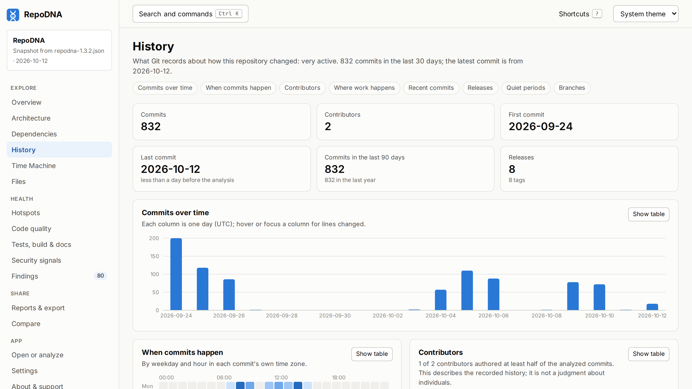

# Git history and code archaeology

When the input is a Git repository, RepoDNA reads its history to answer questions that the
files alone cannot: how the project grew, who worked on what, what changes most, and how
active it is now.

```sh
repodna history
repodna hotspots
repodna show --section history,contributors
```



## How history is read

RepoDNA runs the `git` executable, read-only, through a [hardened
runner](security.md#how-repodna-protects-you): it streams `git log` with raw changes and
line counts in one pass, and reads branches, tags, and remotes separately. It does not
link a Git library, so it supports every repository format your Git supports. Without Git,
the history sections are marked *unavailable* and the rest of the analysis still runs.

- **GitHub branch links**: in development builds after v1.5.0, paste a
  `https://github.com/owner/repo/tree/branch-name` URL to clone the
  underlying repository and check out that branch before analysis. Slashes
  in branch names are supported (including `%2F`), and one trailing URL
  slash is accepted. For slash-containing `/tree/` links, native RepoDNA
  requests the remote's advertised branch and tag names and chooses the
  longest matching ref. Any remaining URL path must be a real directory
  at the checked-out revision; the analysis still covers the **entire
  repository**, not only that directory. Folder paths such as
  `/tree/main/.github` and `/tree/main/docs/design%20notes`
  are accepted when the advertised ref and checked-out directory both
  exist. Directory components may contain spaces or start with a dot,
  but dot traversal and control characters are rejected; explicit
  branch/tag names still follow Git's ref-name rules. No match or
  nonexistent directory fails instead of falling back to the default
  branch. Explicit `--branch`/`--tag` switches bypass this discovery.
  The static hosted web version cannot clone remote Git repositories;
  use the CLI, desktop app, or `repodna serve`. This enhancement is
  development-only and not in the published v1.5.1 maintenance installers.
- **Explicit revisions (development-only)**: `repodna analyze URL --branch
  feat/initial-audio-platform` selects an existing branch, `--tag v1.5.0`
  selects a detached tag, and `--commit <full-SHA>` selects a detached
  commit already available in the fetched objects. These switches are
  mutually exclusive and take precedence over references in GitHub browser URLs.
  Native desktop and local-server forms offer the same choices. GitHub
  `/commit/<full-SHA>` browser links are also recognized. A successful
  checkout is verified against Git's HEAD and the selected revision; missing
  branches or unreachable commits do not fall back to the default branch.
  `--clone-depth` intentionally limits evidence and can exclude commits.
  This new feature is **not included in the published v1.5.1 maintenance installers**.
- **Which checkout**: the Overview and History views identify the branch checked out
  when the analysis ran, if Git supplies it. This is different from the
  repository's default branch and does not imply that any newer remote commits
  have been fetched. Detached HEAD checkouts may not have a branch name.
  When remote-tracking branches exist but `origin/HEAD` is missing,
  RepoDNA leaves the remote default unknown. This applies even when the
  selected local branch is named `main`: its name does not prove the remote
  uses it as its default. Local-only repositories retain their fallback.
  If listing branches fails and `origin/HEAD` is unavailable, RepoDNA also
  reports the default as unknown instead of treating missing branch data as
  proof of a local-only checkout. The same applies if any remote (including
  a nonstandard name such as `upstream`) is configured but has not fetched
  remote-tracking refs: local `main` is not proof of a remote default branch.
- **Which commits**: those reachable from `HEAD`, newest first, up to `analysis.max_commits`
  (50,000 by default; `--max-commits` for one run). If the limit is reached,
  `git.historyTruncated` is set and reports say so.
- **Shallow clones** (for example CI checkouts with `fetch-depth: 1`) are detected and
  flagged with `git.shallow`; history-based results then describe only the fetched
  commits. For a full picture, analyze a full clone.
- **Cancellation**: in development builds after v1.5.0, Git history,
  tree listings, and branch/tag listings check for cancellation between
  individual records, rather than waiting for a fixed-size batch.
- **Merge commits** are counted but carry no file changes of their own.
- **Renames** are followed, so a file's history continues across moves.
- **Identities** are grouped by e-mail address after applying the repository's `.mailmap`.
- **The artifact stores** up to `analysis.artifact_commits` (1,000) commits with hash,
  date, author, and subject; statistics use every analyzed commit.

Everything that should not depend on when you run the analysis (recent churn, "recent"
windows) is measured backwards from the **latest commit**, so the same revision always
gives the same numbers. Only the activity level, which answers "is it active now?", is
measured against the analysis time, and the artifact records that time. In development
builds after v1.5.0, commits with timestamps **later than the analysis time** are
excluded from the 30-, 90-, and 365-day activity windows to avoid false activity
from misconfigured author clocks. They remain in history and are mentioned in
the activity description; days since last commit uses the latest non-future date,
or is unknown when every analyzed commit is future-dated.

## What it reports

| Result | Meaning |
|---|---|
| Timeline | Commits, authors, and lines added and removed per month, and commits per day. Histories shorter than three months are charted per day; reports chart long histories per quarter or year. |
| Contributors | Per identity: commits, lines added and removed, first and last commit, active days, and main areas. |
| Ownership | Share of commits by the top contributor, and how many contributors authored half of all commits. |
| Activity level | `very-active` (at least 30 commits in the last 30 days), `active` (at least 5), `moderate` (at least one in 90 days), `low` (at least one in 365 days), or `dormant`. |
| Releases | Tags that look like versions (`v1.2.3`, `2.0`, `v1.0.0-rc.1`), with their dates and the commits between them. |
| Dormant periods | Gaps without commits of at least `dormant_days` (90). |
| File history | Per file: commits, authors, lines added and removed, when it first appeared and last changed, and earlier paths. |
| Hotspots | Files that change often and are complex; see below. |
| Recent changes | What changed in the `recent_days` (90) before the latest commit: commits, files, directories, and dependency changes. |

## Hotspots

A hotspot is a file where change and complexity meet: code that is modified often and is
hard to modify safely. Files changed in at least `hotspot_min_commits` (3) commits are
ranked by a weighted sum of percentile ranks:

| Signal | Weight |
|---|---|
| Commits touching the file | 30% |
| Churn (lines added and removed) | 20% |
| Commits in the recent window | 15% |
| Highest function complexity | 15% |
| Code lines | 10% |
| Distinct authors | 5% |
| Files that import it | 5% |

Each hotspot lists the signals that put it there, such as "Changed in 42 commits" or
"Contains a function with complexity 31". See also [complexity](complexity.md).

## People

History describes how a repository was worked on, not the quality of anyone's work.
RepoDNA reports identities and their commits, never judgments about people. Squash merges,
pair programming, bots, and people using several e-mail addresses all distort attribution.

- `--anonymize` (or `privacy.anonymize_contributors`) replaces names with "Contributor 1",
  "Contributor 2", and so on in the artifact.
- `--no-commit-messages` (or `privacy.include_commit_messages = false`) keeps commit
  subjects out of the artifact.
- `--privacy public` replaces names with pseudonyms in reports and exports.

See [privacy](privacy.md).

## Findings

`activity.hotspot`, `activity.high-churn-area`, `contributors.concentration`,
`evolution.dormant-period`, `evolution.abandoned-area`, and `evolution.new-module`; see
[the rules reference](repository-dna.md#rules). For how the repository changed over time,
see [the Time Machine](time-machine.md).
